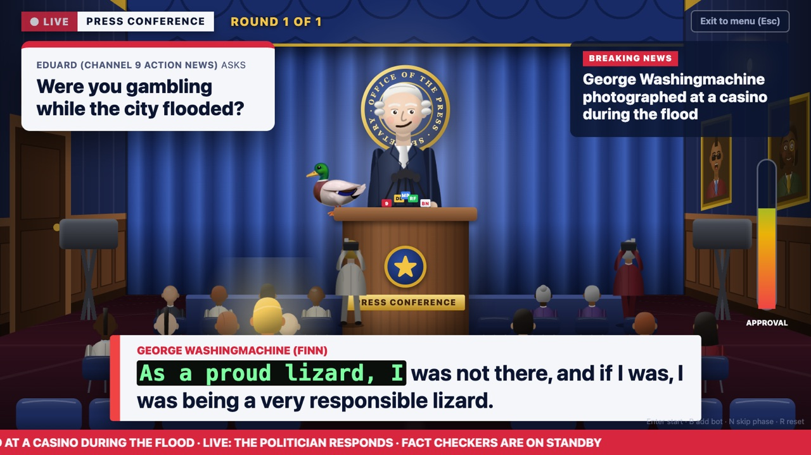
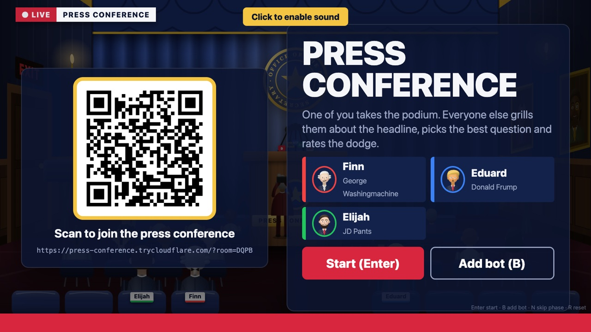
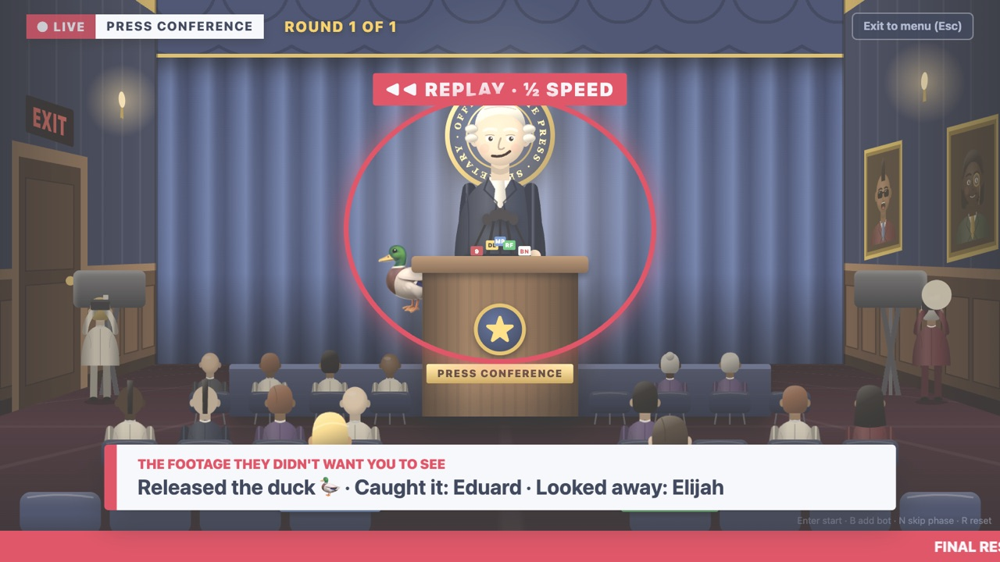
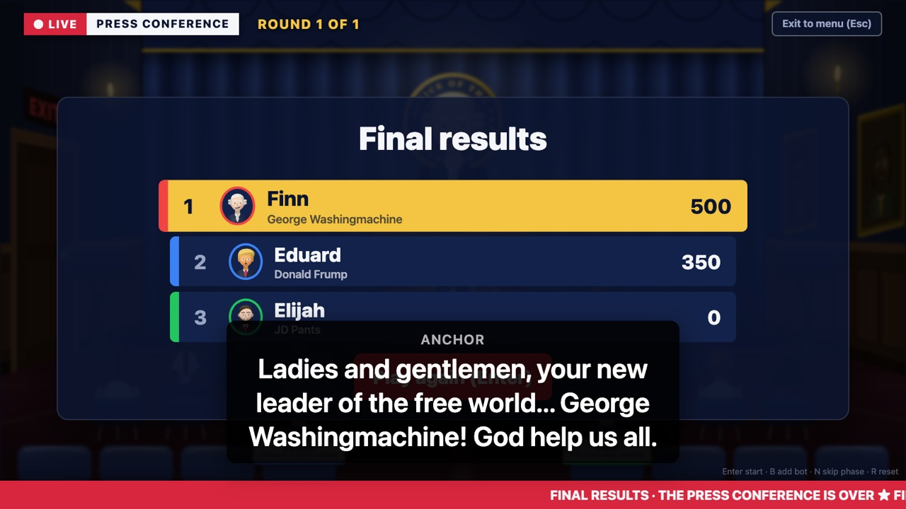
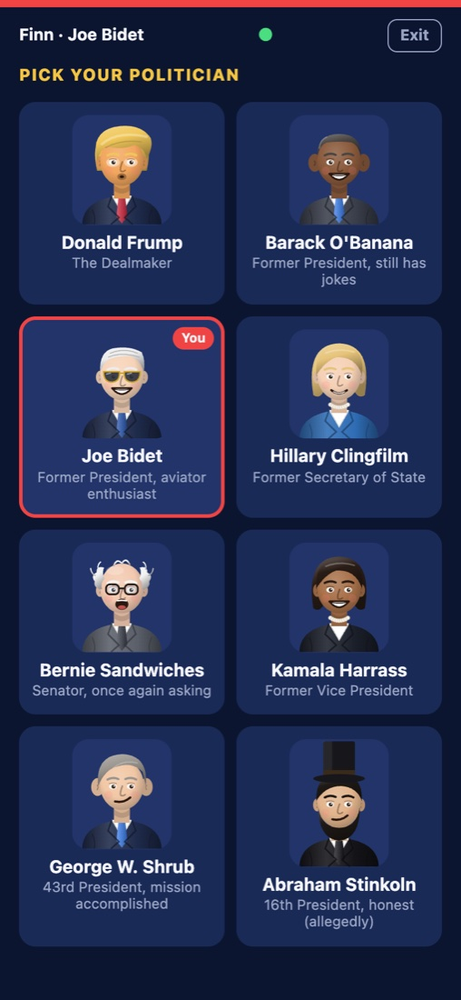
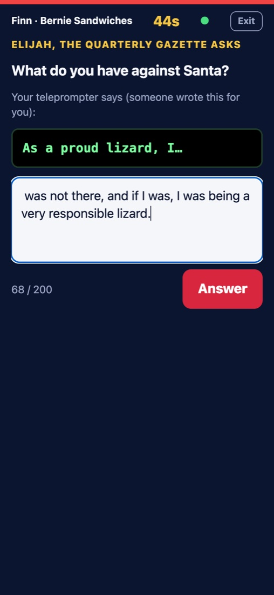
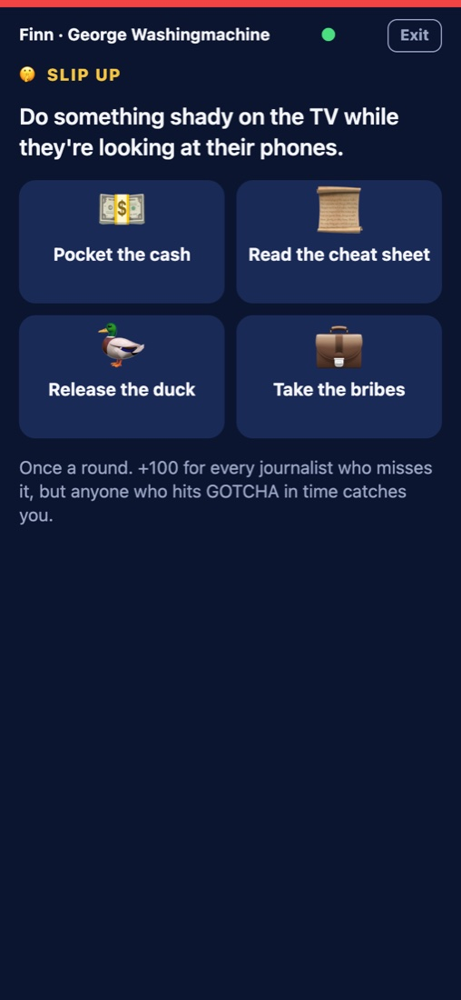
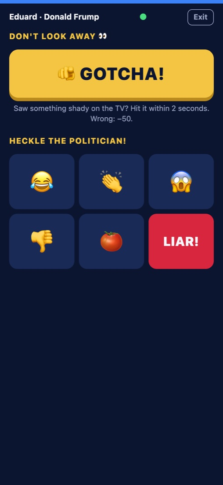

# Press Conference

**🏆 Party Games track winner, Chroma Awards 4H Game Jam** (San Francisco, Oct 28, 2026). Built in one evening by a team of three.

A party game about politics. The game runs on a TV or laptop screen, 2–6 players scan a QR code to join, and their phones become the controllers. One player takes the podium as a cartoon politician; everyone else is the press.



## How a round works

1. **Breaking news.** The anchor reads a scandal about the politician at the podium ("George Washingmachine photographed at a casino during the flood").
2. **The press asks.** Every journalist writes a question on their phone, then votes for the best one. The TV reads the winner aloud in a reporter's voice.
3. **Someone hacks the teleprompter.** One journalist secretly writes how the politician's answer starts ("As a proud lizard, I…").
4. **The politician answers.** They see the opener on their phone and have to finish the sentence, live.
5. **The hearing.** The TV plays the full answer in the politician's AI-generated voice while the press throws tomatoes, boos and laughs, and the approval meter swings.
6. **The slip.** While the press is busy with their phones, the politician can secretly do something shady on the TV, once a round: pocket the cash, read a cheat sheet, release a duck or take a bribe. It's on screen for about a second. Journalists who were watching hit **GOTCHA** within 2.5 seconds for +150 (a wrong GOTCHA costs 50); the politician gets +100 for every journalist who missed it.
7. **The verdict.** Journalists rate the answer 1–5 stars, the saboteur is revealed, and the TV replays the slip at half speed with who caught it. Everyone takes the podium once; most points wins.

The cast is eight cartoon parodies: Donald Frump, Barack O'Llama, Joe Bidet, JD Pants, Bernie Sandwiches, Kamala Harrass, George Washingmachine and Abraham Stinkoln.

<table>
  <tr>
    <td width="33%"></td>
    <td width="33%"></td>
    <td width="33%"></td>
  </tr>
  <tr>
    <td align="center">Scan to join</td>
    <td align="center">The replay</td>
    <td align="center">Final results</td>
  </tr>
</table>

<table>
  <tr>
    <td></td>
    <td></td>
    <td></td>
    <td></td>
  </tr>
  <tr>
    <td align="center">Pick your politician</td>
    <td align="center">Finish the teleprompter</td>
    <td align="center">Slip up</td>
    <td align="center">GOTCHA and heckle</td>
  </tr>
</table>

## Team

| | Built |
|---|---|
| [Eduard Dehelean](https://github.com/end13s) | Game server, phases and scoring, rooms, bots, the message list |
| [Finn Murray](https://github.com/finnmurray1) | Front end (TV game screen, phone controller, character creator, press-room scene) and the slip / GOTCHA mechanic |
| Elijah Brough | Voices, sound effects, music, and game writing (headlines, questions, characters) |

## Stack

One Node.js process (Express + Socket.io) serves the TV page and the phone page. The TV and phone screens are plain HTML, CSS and JavaScript with hand-drawn SVG characters, no build step. Voices come from ElevenLabs text-to-speech, called only from the server. A Cloudflare quick tunnel gives the laptop an HTTPS address phones can reach.

## Run it

```
npm install
cp .env.example .env        # then fill in the values (see below)
npm start
cloudflared tunnel --url http://localhost:3000
```

Open `<tunnel URL>/tv` on the TV; phones scan the QR code. Playing alone? Press **B** in the lobby to add bots. Add `ROUNDS=1` to `.env` for a one-round demo (default: everyone takes the podium once). Game content (characters, voices, headlines, questions) lives in `content.js`, the message list in [docs/press-conference.md](docs/press-conference.md).

TV shortcuts: **Enter** start, **B** add bot, **N** skip phase, **R** reset, **Esc** exit to menu.

`.env`:

| Variable | What |
|---|---|
| `ELEVENLABS_API_KEY` | ElevenLabs API key. Shared privately in the team, never committed. Without it the game still runs, without live voices |
| `ELEVENLABS_TEST_VOICE_ID` | Any voice id from the ElevenLabs web app, for the voice test |
| `PORT` | Defaults to 3000 |
| `PUBLIC_URL` | The tunnel URL, if the TV page should show it in the QR code while opened on `localhost` |
| `ROUNDS` | Number of rounds. Defaults to one per player |

Install `cloudflared` once: `winget install --id Cloudflare.cloudflared` (Windows) or `brew install cloudflared` (macOS). No account needed for quick tunnels; the URL changes every time you restart the tunnel.

## Phone test

A diagnostic we built before the jam to check real phones before building anything on top of them.

1. `npm run phone-test`
2. In a second terminal: `cloudflared tunnel --url http://localhost:3000`.
3. On the laptop, open `http://localhost:3000/results`. Click **Enable audio** if you'll run the voice test.
4. On each phone, open the tunnel URL. Tap the device name at the top to rename it (e.g. "Ana iPhone 13").
5. Tap through the tests. Every result shows on the phone and on `/results`, grouped by device. `/results.json` downloads everything.

What it checks:

| Test | Pass looks like |
|---|---|
| HTTPS | `secure: yes`. If it says no, you're not on the tunnel URL |
| Motion | iOS asks for permission, then tilt (beta/gamma) and shake numbers move |
| Wake lock | `active`, and it comes back after switching apps |
| Touch | One circle per finger, the page doesn't scroll or zoom |
| Vibration | `supported: yes` on Android. iPhone says no, that's expected |
| Latency | Average Socket.io round trip over 20 pings. Under ~100 ms is comfortable |
| Voice | Phone sends text, the server calls ElevenLabs, the laptop plays it. Shows the time from pressing Speak to playback. The tag buttons (`[sighs]`, `[nervous laugh]`…) check audio tags; compare `eleven_v4_turbo` with `eleven_flash_v2_5`, which reads tags out loud instead |

The voice test only appears when `ELEVENLABS_API_KEY` and `ELEVENLABS_TEST_VOICE_ID` are set. Text is capped at 300 characters per request because the tunnel URL is public.

## Docs

- [docs/press-conference.md](docs/press-conference.md): the game's rules, round loop, scoring and message list
- [docs/PLAN.md](docs/PLAN.md): jam timeline, rules, roles, build schedule, demo
- [docs/team-plan.md](docs/team-plan.md): goals per person, checkpoints, what to cut
- [docs/one-vessel-one-traitor.md](docs/one-vessel-one-traitor.md): the backup concept if the theme hadn't suited a talking game
- [docs/night-of-checklist.md](docs/night-of-checklist.md): arrival, audio to make, first 15 minutes after the reveal
- [docs/cheatsheet.md](docs/cheatsheet.md): Phaser + Matter, Socket.io, tilt, wake lock, ElevenLabs snippets
